<div align="center">
  <a name="readme-top"></a>
  <a href="https://jumpserver.com" target="_blank"></a>
  
## 开源特权访问管理（PAM）平台（堡垒机）

[![][license-shield]][license-link]
[![][docs-shield]][docs-link]
[![][deepwiki-shield]][deepwiki-link]
[![][discord-shield]][discord-link]
[![][docker-shield]][docker-link]
[![][github-release-shield]][github-release-link]
[![][github-stars-shield]][github-stars-link]

[English](/README.md) · [中文(简体)](/readmes/README.zh-hans.md) · [中文(繁體)](/readmes/README.zh-hant.md) · [日本語](/readmes/README.ja.md) · [Português (Brasil)](/readmes/README.pt-br.md) · [Español](/readmes/README.es.md) · [Français](/readmes/README.fr.md) · [Русский](/readmes/README.ru.md) · [한국어](/readmes/README.ko.md) · [Tiếng Việt](/readmes/README.vi.md)

</div>

<p align="center">
  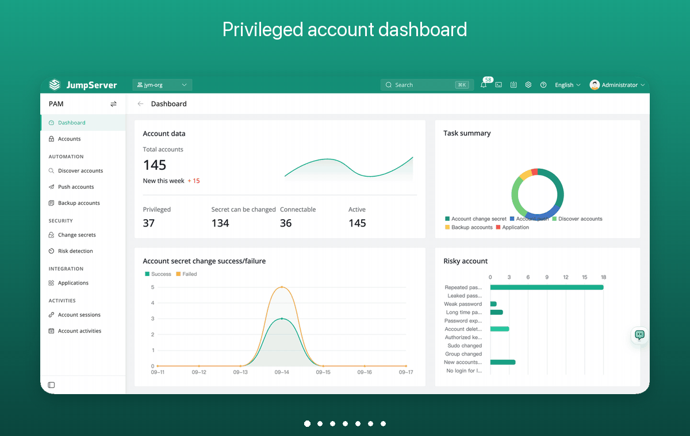
</p>

## 什么是 JumpServer？

JumpServer 是具备 AI 能力的开源特权访问管理（PAM）平台，为 DevOps 和 IT 团队提供统一的工作空间，安全访问 SSH、RDP、Kubernetes、数据库、网站、RemoteApp、VirtualApp 等资源。

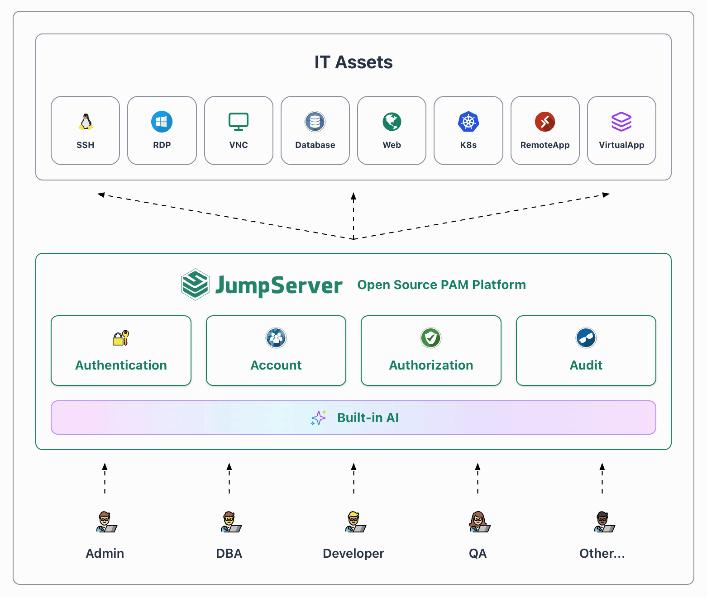

## 版本维护

5.x 为活跃维护版本，4.10.x 为 LTS 版本，3.10.x 仅提供关键问题修复。V3 社区版（CE）将于 **2026 年 12 月 31 日**停止维护，企业版（EE）将于 **2028 年 12 月 31 日**停止维护。

请查看 [SECURITY.md](../SECURITY.md)，了解版本维护状态和安全漏洞报告方式。

## 快速开始

准备一台干净的 64 位 Linux 服务器，至少配备 4 核 CPU 和 8 GB 内存。

```sh
curl -sSL https://github.com/jumpserver/jumpserver/releases/latest/download/quick_start.sh | bash
```

在浏览器中打开 `https://<jumpserver-host>/`，将 `<jumpserver-host>` 替换为运行 JumpServer 的主机 IP 地址或域名。

- 用户名: `admin`
- 密码: `ChangeMe`

## 功能特性

### 特权账号管理

统一发现、推送、备份和改密特权账号，并识别弱密码、泄露密码、长期未改密等风险账号，一个仪表盘全部掌握。

<p align="center">
  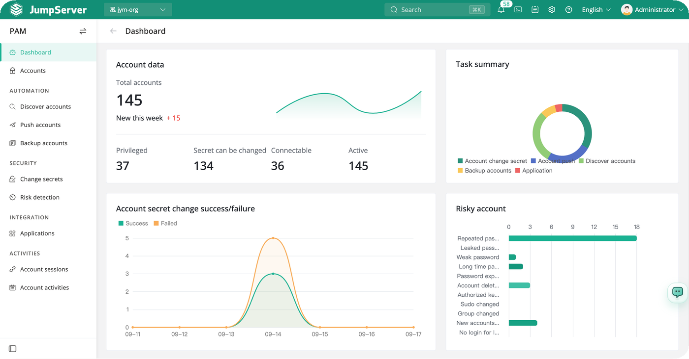
</p>

### 统一资产管理

在一棵资产树中管理主机、网络设备、数据库、云服务、Web 和目录服务，配合细粒度的授权策略和 ACL。

<p align="center">
  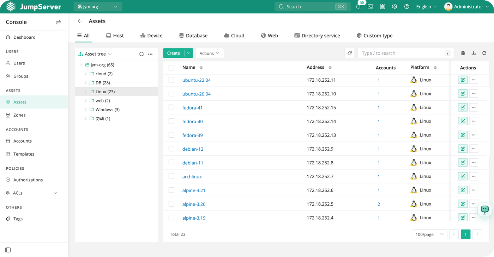
</p>

### 浏览器即可访问一切

选择资产和账号即可通过 SSH、SFTP、RDP、VNC、数据库或 Web 应用连接，Windows 桌面和 RemoteApp 直接在浏览器中运行。

<p align="center">
  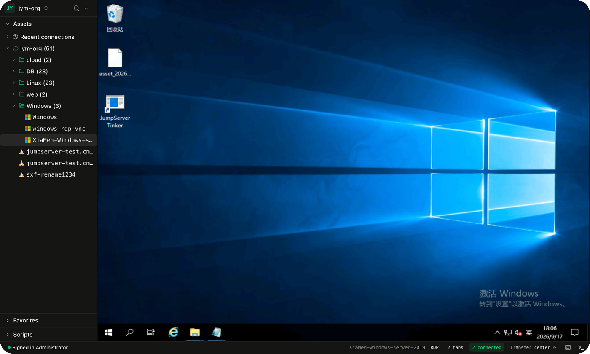
</p>

### AI 赋能运维

在终端中按 <kbd>⌘</kbd> <kbd>K</kbd> 用自然语言描述任务，或让 AI 助手帮你搜索资产、连接会话、执行终端任务。

<p align="center">
  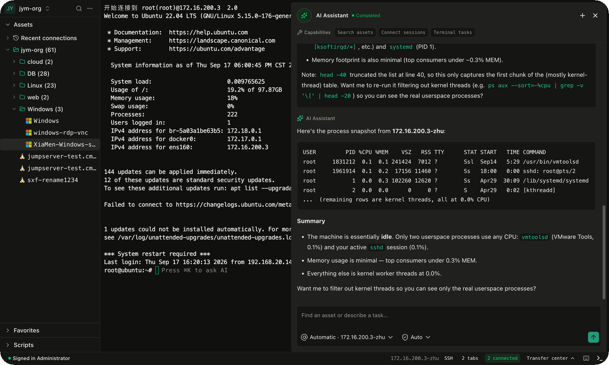
</p>

### KoKo 原生 SSH 体验

使用任意 SSH 客户端接入 JumpServer，在 TUI 中浏览已授权资产，并在多个会话之间快速切换，无需离开终端。

<p align="center">
  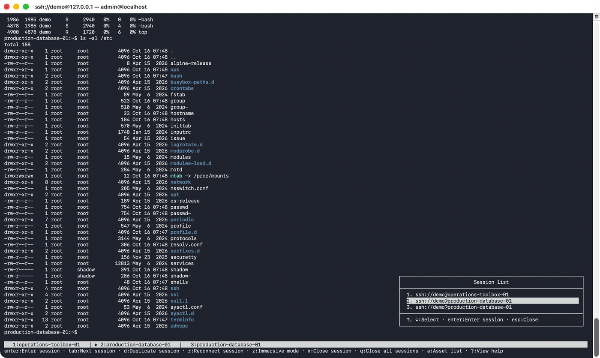
</p>

<details>
<summary><b>更多截图</b></summary>
<br/>

<p align="center">
  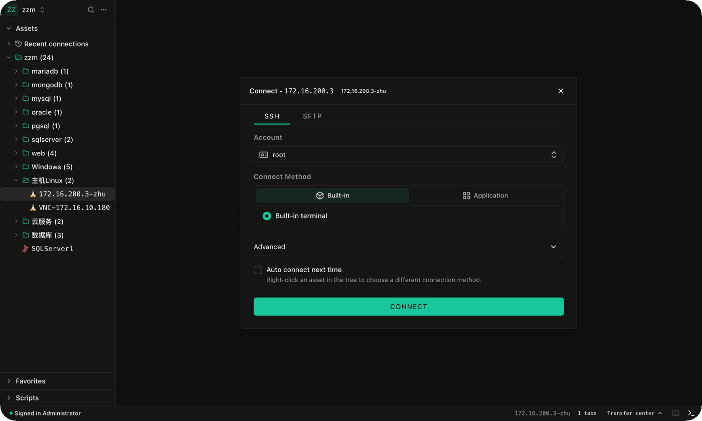
  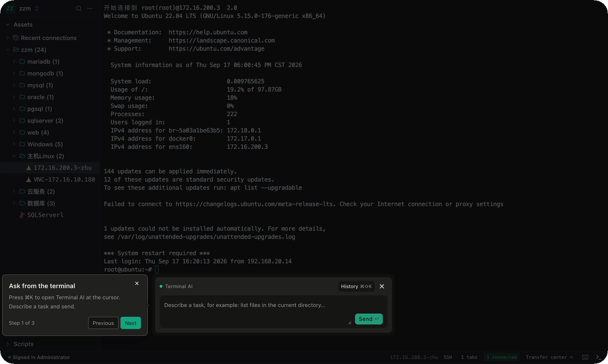
</p>

<p align="center">
  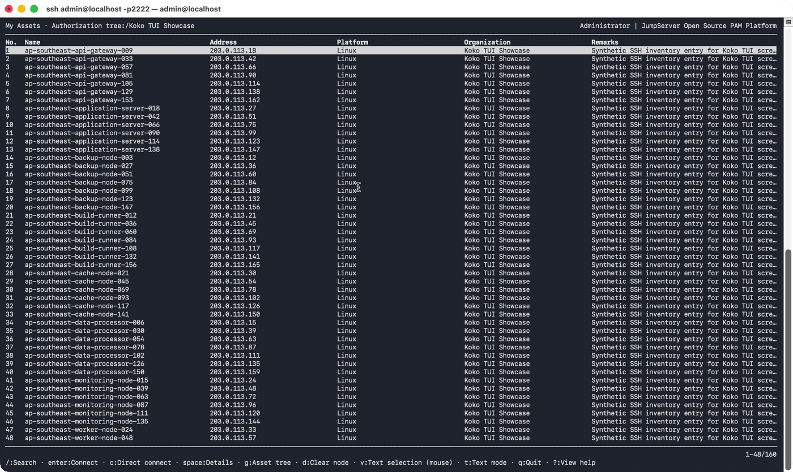
  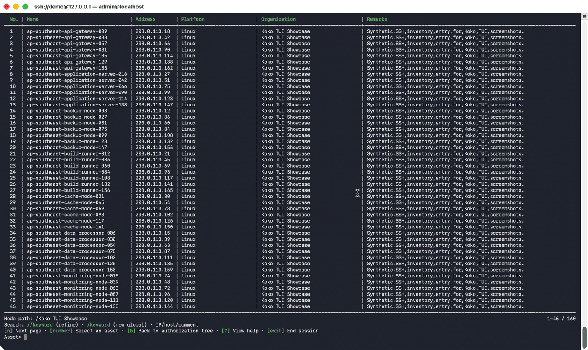
</p>

<p align="center">
  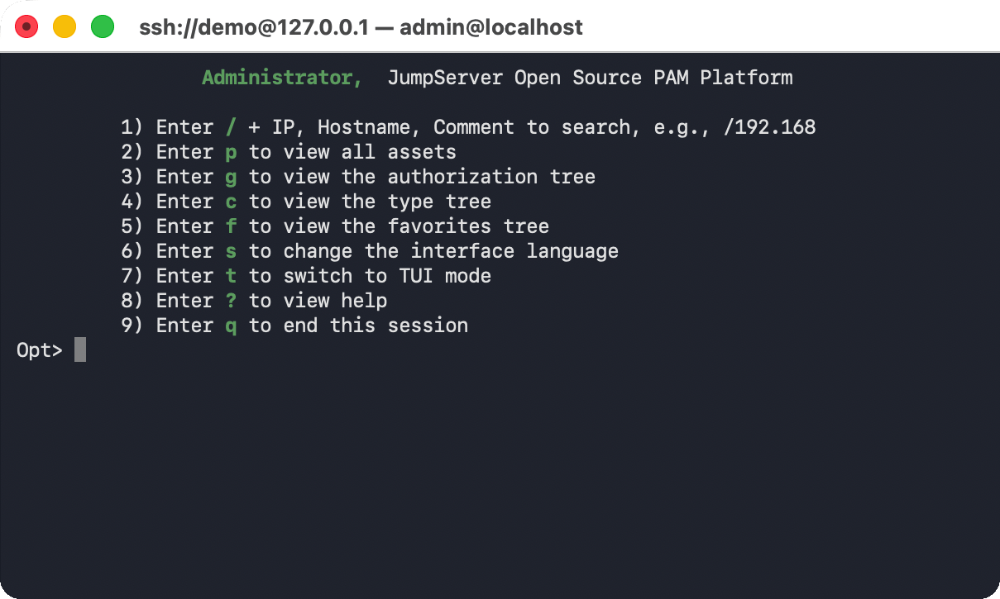
</p>

</details>

## 组件

JumpServer 按职责划分组件。核心项目提供平台、Web 界面、终端、协议连接和 AI 能力；企业版组件扩展应用与协议访问；支撑服务处理会话录像和主机运维；部署工具简化安装与 Web 资源交付。

### 核心项目

<table width="100%">
  <thead>
    <tr>
      <th width="160" align="left">项目</th>
      <th width="135" align="center"><div align="center">版本</div></th>
      <th width="550" align="center"><div align="center">说明</div></th>
    </tr>
  </thead>
  <tbody>
    <tr>
      <td width="160" align="left" nowrap><a href="https://github.com/jumpserver/jumpserver">JumpServer</a></td>
      <td width="135" align="center"><div align="center"><a href="https://github.com/jumpserver/jumpserver/tags"></a></div></td>
      <td width="550" align="left">开源特权访问管理平台</td>
    </tr>
    <tr>
      <td width="160" align="left" nowrap><a href="https://github.com/jumpserver/lina">Lina</a></td>
      <td width="135" align="center"><div align="center"><a href="https://github.com/jumpserver/lina/tags"></a></div></td>
      <td width="550" align="left">JumpServer Web 界面</td>
    </tr>
    <tr>
      <td width="160" align="left" nowrap><a href="https://github.com/jumpserver/luna">Luna</a></td>
      <td width="135" align="center"><div align="center"><a href="https://github.com/jumpserver/luna/tags"></a></div></td>
      <td width="550" align="left">JumpServer Web 终端与原生客户端</td>
    </tr>
    <tr>
      <td width="160" align="left" nowrap><a href="https://github.com/jumpserver/koko">KoKo</a></td>
      <td width="135" align="center"><div align="center"><a href="https://github.com/jumpserver/koko/tags"></a></div></td>
      <td width="550" align="left">JumpServer 通用协议连接器与代理</td>
    </tr>
    <tr>
      <td width="160" align="left" nowrap><a href="https://github.com/jumpserver/chen">Chen</a></td>
      <td width="135" align="center"><div align="center"><a href="https://github.com/jumpserver/chen/tags"></a></div></td>
      <td width="550" align="left">JumpServer Web 数据库连接器</td>
    </tr>
    <tr>
      <td width="160" align="left" nowrap><a href="https://github.com/jumpserver/kael">Kael</a></td>
      <td width="135" align="center"><div align="center"><a href="https://github.com/jumpserver/kael/tags"></a></div></td>
      <td width="550" align="left">JumpServer AI 组件</td>
    </tr>
  </tbody>
</table>

### 企业版组件

<table width="100%">
  <thead>
    <tr>
      <th width="160" align="left">项目</th>
      <th width="135" align="center"><div align="center">版本</div></th>
      <th width="550" align="center"><div align="center">说明</div></th>
    </tr>
  </thead>
  <tbody>
    <tr>
      <td width="160" align="left" nowrap><a href="https://github.com/jumpserver/tinker">Tinker</a></td>
      <td width="135" align="center"><div align="center"></div></td>
      <td width="550" align="left">JumpServer Windows 应用连接器（社区版可免费使用）</td>
    </tr>
    <tr>
      <td width="160" align="left" nowrap><a href="https://github.com/jumpserver/Panda">Panda</a></td>
      <td width="135" align="center"><div align="center"></div></td>
      <td width="550" align="left">JumpServer 企业版 Linux 应用连接器</td>
    </tr>
    <tr>
      <td width="160" align="left" nowrap><a href="https://github.com/jumpserver/razor">Razor</a></td>
      <td width="135" align="center"><div align="center"></div></td>
      <td width="550" align="left">JumpServer 企业版 RDP 协议代理</td>
    </tr>
    <tr>
      <td width="160" align="left" nowrap><a href="https://github.com/jumpserver/magnus">Magnus</a></td>
      <td width="135" align="center"><div align="center"></div></td>
      <td width="550" align="left">JumpServer 企业版数据库协议代理</td>
    </tr>
    <tr>
      <td width="160" align="left" nowrap><a href="https://github.com/jumpserver/nec">Nec</a></td>
      <td width="135" align="center"><div align="center"></div></td>
      <td width="550" align="left">JumpServer 企业版 VNC 协议代理</td>
    </tr>
  </tbody>
</table>

### 支撑服务

<table width="100%">
  <thead>
    <tr>
      <th width="160" align="left">项目</th>
      <th width="135" align="center"><div align="center">版本</div></th>
      <th width="550" align="center"><div align="center">说明</div></th>
    </tr>
  </thead>
  <tbody>
    <tr>
      <td width="160" align="left" nowrap><a href="https://github.com/jumpserver/video-worker">Video&nbsp;Worker</a></td>
      <td width="135" align="center"><div align="center"></div></td>
      <td width="550" align="left">JumpServer 企业版会话录像转码服务</td>
    </tr>
    <tr>
      <td width="160" align="left" nowrap><a href="https://github.com/jumpserver/jdmc">JDMC</a></td>
      <td width="135" align="center"><div align="center"></div></td>
      <td width="550" align="left">JumpServer 企业版主机运维与管理服务</td>
    </tr>
  </tbody>
</table>

### 部署与工具

<table width="100%">
  <thead>
    <tr>
      <th width="160" align="left">项目</th>
      <th width="135" align="center"><div align="center">版本</div></th>
      <th width="550" align="center"><div align="center">说明</div></th>
    </tr>
  </thead>
  <tbody>
    <tr>
      <td width="160" align="left" nowrap><a href="https://github.com/jumpserver/installer">Installer</a></td>
      <td width="135" align="center"><div align="center"><a href="https://github.com/jumpserver/installer/tags"></a></div></td>
      <td width="550" align="left">JumpServer 安装与管理工具</td>
    </tr>
    <tr>
      <td width="160" align="left" nowrap><a href="https://github.com/jumpserver/docker-web">Docker&nbsp;Web</a></td>
      <td width="135" align="center"><div align="center"><a href="https://github.com/jumpserver/docker-web/tags"></a></div></td>
      <td width="550" align="left">JumpServer Web 网关与静态资源</td>
    </tr>
  </tbody>
</table>

## 参与贡献

欢迎提交贡献。请阅读 [CONTRIBUTING.md][contributing-link] 了解贡献指南。

## 许可证

版权所有 (c) 2014-2026 FIT2CLOUD。保留所有权利。

本项目依据 GNU 通用公共许可证第 3 版（GPLv3，以下简称“许可证”）授权；您只能在遵守许可证的前提下使用本文件。许可证副本可从以下地址获取：

https://www.gnu.org/licenses/gpl-3.0.html

除非适用法律要求或另有书面约定，根据许可证分发的软件均按“原样”提供，不附带任何明示或暗示的保证或条件。有关权限和限制，请参阅许可证中的具体规定。

<!-- JumpServer official link -->
[docs-link]: https://jumpserver.com/docs
[discord-link]: https://discord.com/invite/W6vYXmAQG2
[deepwiki-link]: https://deepwiki.com/jumpserver/jumpserver/
[contributing-link]: https://github.com/jumpserver/jumpserver/blob/dev/CONTRIBUTING.md

<!-- JumpServer Other link-->
[license-link]: https://www.gnu.org/licenses/gpl-3.0.html
[docker-link]: https://hub.docker.com/u/jumpserver
[github-release-link]: https://github.com/jumpserver/jumpserver/releases/latest
[github-stars-link]: https://github.com/jumpserver/jumpserver
[github-issues-link]: https://github.com/jumpserver/jumpserver/issues

<!-- Shield link-->
[docs-shield]: https://img.shields.io/badge/documentation-148F76
[github-release-shield]: https://img.shields.io/github/v/release/jumpserver/jumpserver
[github-stars-shield]: https://img.shields.io/github/stars/jumpserver/jumpserver?color=%231890FF&style=flat-square   
[docker-shield]: https://img.shields.io/docker/pulls/jumpserver/jms_all.svg
[license-shield]: https://img.shields.io/github/license/jumpserver/jumpserver
[deepwiki-shield]: https://img.shields.io/badge/deepwiki-devin?color=blue
[discord-shield]: https://img.shields.io/discord/1194233267294052363?style=flat&logo=discord&logoColor=%23f5f5f5&labelColor=%235462eb&color=%235462eb
